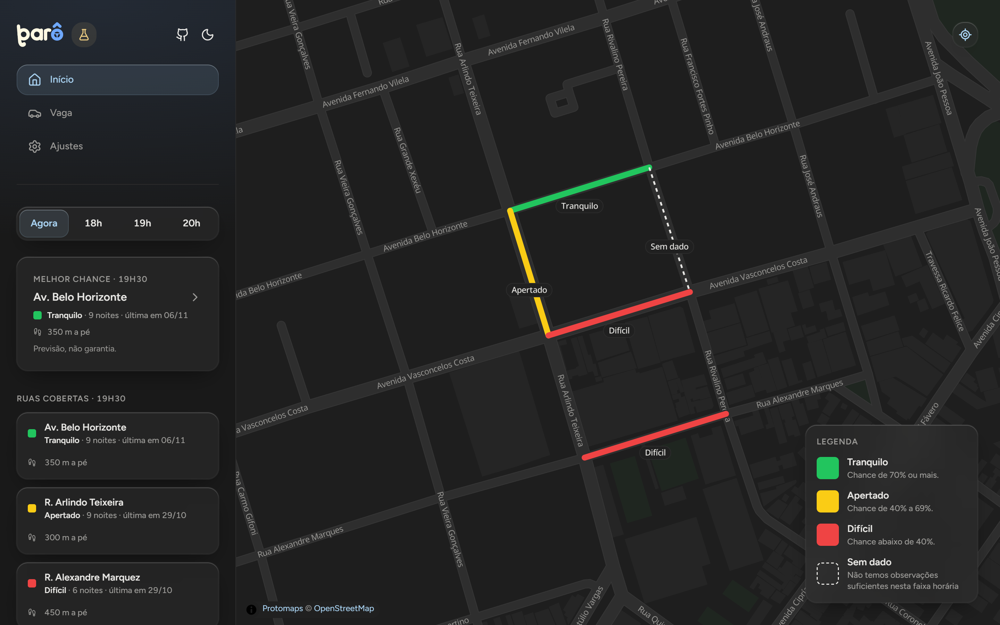
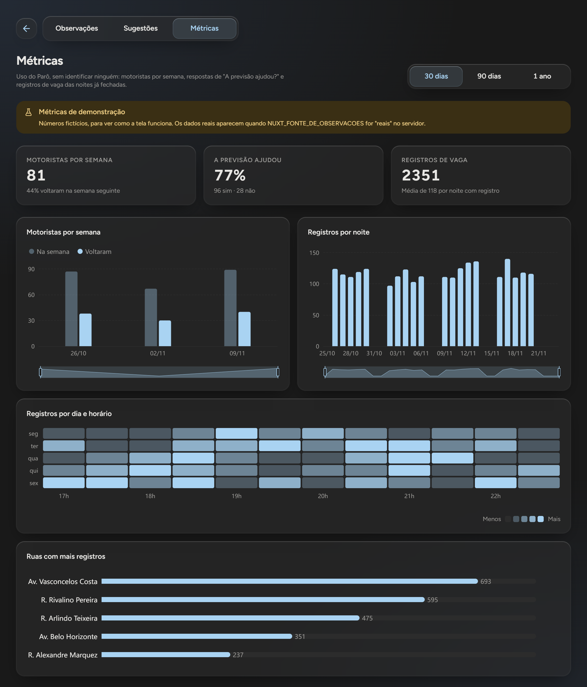

# Parô

O Parô mostra a chance de encontrar vaga de estacionamento por rua e horário no entorno da ESAMC Uberlândia. É voltado a quem dirige até lá à noite. A chance cobre cinco ruas cobertas, das 17h às 23h, em faixas horárias de 30 minutos.

O app é um PWA instalável, sem cadastro e sem login. No desktop, as telas ficam numa barra lateral ao lado do mapa.



## Telas

| Tela | Caminho | O que mostra |
| --- | --- | --- |
| Primeira visita | `/primeira-visita` | O que é o Parô, antes do primeiro uso. |
| Início | `/` | Melhor chance e lista das ruas cobertas na faixa horária escolhida. |
| Mapa | `/mapa` | Ruas cobertas no mapa, pintadas pela faixa de chance. |
| Detalhe da rua | `/ruas/[id]` | Chance de cada faixa horária da noite, melhor faixa e saídas previstas. |
| Vaga | `/minha-vaga` | Registro de vaga com a saída prevista e o ponto do carro. |
| Ajustes | `/ajustes` | Tema, rotina, forma de colaborar, sugestão de rua, privacidade e Área da equipe. |
| Área da equipe | `/equipe/observacoes`, `/equipe/metricas`, `/equipe/sugestoes` | Observações de campo, métricas de uso e sugestões de rua. Pede a chave da equipe. |

A Área da equipe mostra as métricas de uso em gráficos ECharts.



## Como a chance é calculada

- Uma **observação** é a contagem, feita em campo numa noite, das vagas existentes e ocupadas de uma rua coberta numa faixa horária.
- Uma rua coberta está **cheia** numa observação quando a ocupação é de 85% ou mais.
- A **chance** é o percentual das observações do semestre, em dias letivos normais, em que a rua coberta não estava cheia. Exemplo: 7 de 10 noites abaixo de 85% dá chance de 70%.
- A chance aparece em três **faixas de chance**: Tranquilo (70% ou mais), Apertado (40% a 69%) e Difícil (menos de 40%).
- Com menos de 4 observações, a rua coberta aparece como **Sem dado** naquela faixa horária.
- Os registros de vaga não entram na chance. Eles viram as **saídas previstas** da noite atual, mostradas à parte.

## Dados e privacidade

- O app não tem cadastro. A rotina, o registro de vaga com o código e o ponto do carro ficam no celular.
- Os registros de vaga são apagados ao fim de cada noite. Antes disso, o servidor guarda só o total por rua coberta e faixa horária.
- As sessões com identificador mensal ficam no servidor por 60 dias. Depois viram totais e são apagadas.
- O mapa usa tiles próprios em PMTiles, publicados com o app. Nenhum provedor de tiles recebe o IP de quem vê o mapa.

## Tecnologias

- [Nuxt 4](https://nuxt.com) com [Nuxt UI 4](https://ui.nuxt.com) e Tailwind CSS 4.
- PWA com `@vite-pwa/nuxt`.
- Mapa com MapLibre GL e PMTiles.
- Gráficos da Área da equipe e do Detalhe da rua com ECharts (`vue-echarts`).
- Postgres no Supabase em produção. Sem `DATABASE_URL`, o servidor usa o PGLite em `.data/pglite`.
- Publicação na Vercel, com o fechamento diário das noites no Vercel Cron.
- Testes com Vitest. Lint com ESLint (`@nuxt/eslint`).

## Rodar localmente

Pré-requisitos: Node.js e npm.

1. Instale as dependências:

   ```bash
   npm install
   ```

2. Crie o `.env` a partir do exemplo e preencha as variáveis que você vai usar:

   ```bash
   cp .env.example .env
   ```

3. Suba o servidor de desenvolvimento:

   ```bash
   npm run dev
   ```

4. Abra `http://localhost:3000`.

Se nenhuma `DATABASE_URL` estiver definida, o servidor usa o PGLite local em `.data/pglite`.

Fora das 17h às 23h, a área coberta não tem faixa horária ativa. Para testar a noite em outro horário, suba o servidor com o relógio falso:

```bash
npm run dev:relogio -- 21:30
```

O `dev:relogio` usa a mesma pasta `.data/pglite` do `npm run dev`. Pare o outro servidor antes.

## Variáveis de ambiente

| Variável | Uso | Sem a variável |
| --- | --- | --- |
| `DATABASE_URL` | Postgres do app (Supabase). | O servidor usa o PGLite em `.data/pglite`. |
| `CRON_SECRET` | Segredo do fechamento diário das noites. A Vercel envia `Authorization: Bearer <CRON_SECRET>` para `/api/cron/fechar-noites`. | A rota recusa todas as chamadas. |
| `NUXT_CHAVE_DA_EQUIPE` | Chave da equipe. Protege as rotas `/api/equipe/*`, que recebem `Authorization: Bearer <chave>`. | As rotas da equipe recusam todas as chamadas. |
| `NUXT_FONTE_DE_OBSERVACOES` | Com `reais`, a chance e as métricas da equipe usam os dados do banco. | O app usa observações e métricas fictícias e mostra o aviso de demonstração. |

Use valores aleatórios longos em `CRON_SECRET` e `NUXT_CHAVE_DA_EQUIPE`. Não versione o `.env` com valores reais.

## Scripts

| Comando | O que faz |
| --- | --- |
| `npm run dev` | Sobe o servidor de desenvolvimento em `http://localhost:3000`. |
| `npm run dev:relogio -- [hora]` | Sobe o servidor de desenvolvimento com o relógio falso. Sem hora, parte de 20h. |
| `npm run build` | Gera o build de produção. |
| `npm run preview` | Serve o build de produção. |
| `npm run typecheck` | Confere os tipos. |
| `npm run lint` | Roda o ESLint. `npm run lint:fix` corrige o que for possível. |
| `npm test` | Roda os testes com Vitest. |

## Área da equipe

A Área da equipe fica em Ajustes, na seção Equipe. Ela pede a chave da equipe (`NUXT_CHAVE_DA_EQUIPE`). A chave fica só na aba do navegador e vai no cabeçalho `Authorization`, nunca na URL.

- **Observações:** a equipe registra as contagens de campo de cada rua coberta e faixa horária.
- **Métricas:** motoristas por semana e quantos voltaram na semana seguinte, respostas de "A previsão ajudou?", registros de vaga por noite e por dia e horário, e ruas com mais registros. Períodos de 30 dias, 90 dias e 1 ano.
- **Sugestões:** os pedidos de novas ruas ou trechos enviados pelos motoristas.

## Fechamento diário das noites

O Vercel Cron chama `/api/cron/fechar-noites` todo dia às 3h30 UTC (0h30 em Brasília). A rota faz duas coisas:

1. Fecha as noites anteriores que ainda têm registros de vaga: grava o total por rua coberta e faixa horária e apaga os registros.
2. Consolida as sessões em totais por semana e apaga as sessões com mais de 60 dias.

## Ajustes visuais (F4)

Em desenvolvimento, a tecla F4 abre um painel que muda ao vivo o vidro dos cards, botões e abas: raio, desfoque, brilho, fundo, borda e sombra, nos temas claro e escuro. "Copiar ajustes" gera o bloco de variáveis CSS para colar em `app/assets/css/main.css`. O painel não vai para o build de produção.

## Estrutura

```text
app/          # telas, componentes, composables e estilos (Nuxt)
server/       # rotas da API e módulos do servidor (server/utils)
shared/       # tipos e regras usados pelo app e pelo servidor
public/       # ícones, logo, símbolo da marca, grafismos e arquivos do mapa
scripts/      # relógio falso para desenvolvimento
docs/         # decisões, módulos, design system e plano do projeto
```

## Documentação

- [`CONTEXT.md`](CONTEXT.md): glossário do domínio (rua coberta, faixa horária, chance, faixa de chance e outros termos).
- [`docs/adr/`](docs/adr): decisões de arquitetura e de produto.
- [`docs/modulos.md`](docs/modulos.md): módulos do app e do servidor.
- [`docs/design/design-system.md`](docs/design/design-system.md): design system.
- [`docs/projeto.md`](docs/projeto.md): relatório do projeto, da pesquisa de campo ao produto.
